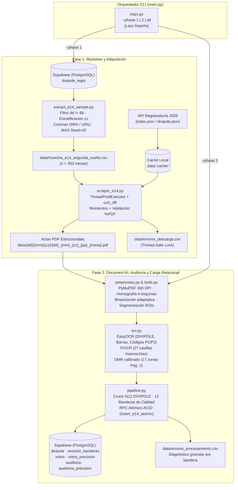
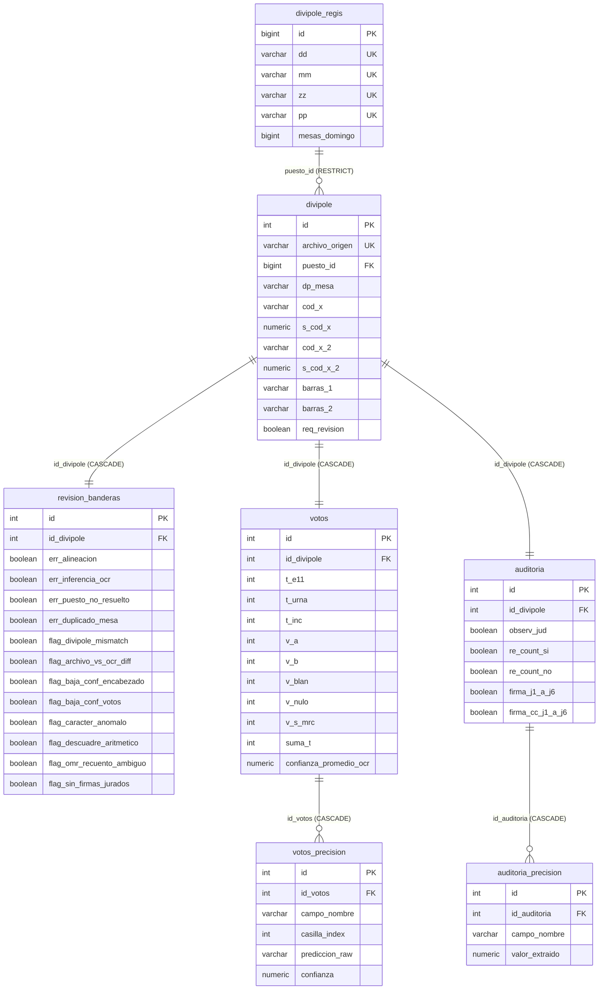

# E-14 Document AI & ETL Pipeline | Visión por Computadora, OCR/HTR y Auditoría Electoral

Pipeline modular end-to-end de ingeniería de datos, diseño experimental y Document AI desarrollado para la adquisición muestral, digitalización automatizada y auditoría relacional de formularios electorales **E-14** (Segunda Vuelta Presidencial 2026, Colombia).

El sistema opera en **dos fases desacopladas** ejecutables de forma independiente o secuencial desde `main.py`:
* **Fase 1 (Ingestión, Muestreo y Scraping):** Extracción paginada de DIVIPOLE desde PostgreSQL (Supabase), muestreo probabilístico estratificado ($n = 383$) y motor de scraping concurrente con evasión TLS y caché local.
* **Fase 2 (Visión Artificial, OCR/HTR/OMR y Carga ACID):** Rasterización con `PyMuPDF`, rectificación homográfica por marcas fiduciarias, inferencia híbrida (`EasyOCR` + `TrOCR` + `OMR` calibrado), evaluación de **12 banderas de auditoría** y persistencia atómica en PostgreSQL vía procedimiento almacenado RPC.

---

## 1. Arquitectura del Flujo de Datos (End-to-End)



---

## 2. Componentes del Sistema

### Fase 1: Ingestión, Muestreo y Scraping (`src/ingestion/` y `src/scraper/`)

#### Módulo de Ingestión y Muestreo (`src/ingestion/extract_e14_sample.py`)
* **Persistencia Relacional:** Conexión paginada contra **Supabase (PostgreSQL)** sobre la tabla maestra `divipole_regis`, construida a partir del documento oficial [divipole_definitiva_2026.pdf](https://www.registraduria.gov.co/IMG/pdf/divipole_definitiva_2026.pdf) convertido a CSV (`data/divipole_2026.csv`).
* **Delimitación del Universo:** Exclusión estricta de mesas consulares (`dd == '88'`) por ausencia de actas digitalizadas en el portal de escrutinio nacional:
  * **Puestos procesados:** `13.489`
  * **Universo estadístico ($N$):** `118.346` mesas domésticas.
* **Diseño Experimental (Fórmula de Cochran para poblaciones finitas):**

$$n = \frac{N \cdot Z^2 \cdot p \cdot q}{e^2 \cdot (N - 1) + Z^2 \cdot p \cdot q}$$

  * $Z = 1.96$ ($95\%$ Confianza), $e = 0.05$ ($\pm 5\%$ Margen de Error), $p = 0.5$, $q = 1 - p = 0.5$.
  * **Tamaño muestral resultante:** $n = 383\text{ mesas}$.

* **Estratificación Proporcional por Zona (`zz`):**

| Estrato Operativo | Código Zona (`zz`) | Total Mesas ($N_i$) | Representatividad | Muestra ($n_i$) |
| :--- | :--- | :--- | :--- | :--- |
| **Urbano** | `00` a `97` | 98.819 | 83.50% | **319** |
| **Rural** | `99` | 19.365 | 16.36% | **63** |
| **Penitenciario** | `98` | 162 | 0.14% | **1** |
| **Total** | — | **118.346** | **100.0%** | **383** |

* **Extracción Reproducible:** Expansión a nivel atómico de mesa individual y Muestreo Aleatorio Simple (MAS) sin reemplazo por estrato con semilla fija (`SEED = 42`).

#### Módulo de Scraping Dirigido (`src/scraper/scraper_e14.py`)
* **Extracción Selectiva:** Descarga exclusiva de las 383 mesas especificadas en `muestra_e14_segunda_vuelta.csv`, resolviendo códigos numéricos y alfanuméricos (`A1`, `B1`, `B2`, `B3`).
* **Resiliencia de Red y Evasión TLS:** Uso de `curl_cffi` con impersonación de navegador (`chrome110`), *jitter* aleatorio y **reintentos progresivos (`MAX_RETRIES = 3`)** ante timeouts o códigos HTTP transitorios.
* **Idempotencia y Caché:** Almacenamiento en `data/.cache/` de los árboles JSON intermedios y omisión automática de PDFs ya descargados y no vacíos.
* **Integridad y Auditoría:** Verificación de cabecera binaria `%PDF` y registro concurrente (*thread-safe* con `threading.Lock`) con marca temporal ISO en `data/errores_descarga.csv`.

---

### Fase 2: Visión Artificial, Inferencia OCR/HTR/OMR y Carga ACID (`src/processing/`)

#### Preprocesamiento y Segmentación (`preprocess.py` & `tools.py`)
* **Rasterización Portable (`PyMuPDF`):** Renderizado en memoria a **300 DPI** con `fitz` (3 canales RGB garantizados), eliminando la dependencia externa de `poppler` en Windows/Linux/macOS.
* **Rectificación Homográfica (`align_page`):** Búsqueda de los 4 cuadros fiduciarios negros en las esquinas (`Top-Left`, `Top-Right`, `Bottom-Left`, `Bottom-Right`) mediante umbral automático Otsu, filtro de área, aproximación poligonal de 4 vértices y relación de aspecto cuadrada ($1.0 \pm 0.1$), seguida de `cv2.warpPerspective`.
* **Binarización Adaptativa:** Umbralización por media local (`ADAPTIVE_THRESH_MEAN_C`, `block_size=81`, `C=40`) calibrada para escaneos con iluminación irregular.
* **Segmentación Proporcional de ROIs (`tools.py`):** Recorte por coordenadas relativas en 4 diccionarios: encabezados comunes de Página 1 y Página 2 (`Divipole`, `Barras`, `Codigo`), **27 casillas individuales** de dígitos manuscritos (Página 1) y **17 zonas OMR** de constancias, recuento, firmas y cédulas (Página 2).

#### Motor de Inferencia Híbrida (`ocr.py`)
* **EasyOCR (`es`):** Lectura de texto impreso sobre encabezados. Ordenamiento vertical (`sort_axis="y"`) para `DIVIPOLE` (con regex multilínea y soporte para puestos alfanuméricos) y fusión horizontal (`sort_axis="x"`) para evitar fragmentación en códigos de barras y códigos de seguridad `X-#-#-#-# X` de ambas páginas.
* **TrOCR (`microsoft/trocr-base-handwritten`):** Instanciación única en memoria con inicialización desacoplada (`AutoImageProcessor` + `RobertaTokenizer`) para evitar fallos de conversión *fast-tokenizer*. Ejecuta decodificación forzada de 1 paso sumando probabilidades softmax BPE únicamente sobre el vocabulario objetivo (`0123456789.*#-/\\`), precedida por filtro OMR de casilla vacía (`EN_BLANCO`).
* **OMR Calibrado por Zona (`OMR_ZONE_THRESHOLDS`):** Medición de densidad de píxeles negros sobre el núcleo recortado con umbrales independientes según el ruido impreso de cada casilla (`Observ_jud`: `7.5%`, `Re_count_si`: `16.0%`, `Re_count_no`: `20.0%`, renglones: `6.0%`, firmas: `4.5%`, cédulas: `7.5%`).

#### Persistencia Atómica ACID y Control de Calidad (`pipeline.py` & `sql/schema.sql`)
* **Transacción Atómica sin JSONB (`insert_e14_atomic`):** Procedimiento almacenado PL/pgSQL que recibe tipos escalares y arreglos paralelos nativos (`TEXT[]`, `INTEGER[]`, `NUMERIC[]`) desempaquetados con `UNNEST()`. Garantiza escritura todo-o-nada sobre las 6 tablas de la Fase 2 en **1 sola llamada HTTP**, elimina registros a medias y auto-repara filas incompletas al reejecutar.
* **Catálogo de 12 Banderas Granulares (`public.revision_banderas`):**

| Categoría | Bandera (`BOOLEAN`) | Regla de Activación |
| :--- | :--- | :--- |
| **Pipeline** | `err_alineacion` | PDF $< 2$ páginas o fallo al detectar las 4 marcas fiduciarias. |
| **Pipeline** | `err_inferencia_ocr` | Excepción en tiempo de ejecución durante EasyOCR, TrOCR u OMR. |
| **Integridad BD** | `err_puesto_no_resuelto` | Tupla `(dd, mm, zz, pp)` leída por OCR inexistente en `divipole_regis`. |
| **Integridad BD** | `err_duplicado_mesa` | Colisión `UNIQUE (puesto_id, dp_mesa)` en BD; guarda `dp_mesa = NULL` y alerta. |
| **Encabezado** | `flag_divipole_mismatch` | Discrepancia en metadatos DIVIPOLE entre Página 1 y Página 2. |
| **Encabezado** | `flag_archivo_vs_ocr_diff` | Códigos leídos por OCR difieren del nombre oficial `dd_mm_zz_pp_mesa.pdf`. |
| **Encabezado** | `flag_baja_conf_encabezado` | Confianza `< 0.75` en barras o `< 0.55` en `Codigo`, patrón de barras de 15 dígitos inválido (`b1[:11] != b2[:11]` o páginas `01`/`02`), o `Codigo != Codigo_2` / $\neq 7$ dígitos. |
| **Votos (TrOCR)** | `flag_baja_conf_votos` | Alguna casilla numérica (`0`–`9`) $< 0.75$ o promedio global del acta $< 0.80$. |
| **Votos (TrOCR)** | `flag_caracter_anomalo` | TrOCR predice un símbolo especial (`*`, `#`, `-`, `/`, `\`, `.`) por tachón o marca. |
| **Aritmética** | `flag_descuadre_aritmetico` | $(v\_a + v\_b + v\_blan + v\_nulo + v\_s\_mrc \neq suma\_t)$ o $((t\_urna - t\_inc) \neq suma\_t)$. |
| **Auditoría OMR** | `flag_omr_recuento_ambiguo` | `Re_count_si` y `Re_count_no` detectados como `True` simultáneamente. |
| **Auditoría OMR** | `flag_sin_firmas_jurados` | Ninguna de las 6 casillas de firma (`Firma_J1` a `Firma_J6`) supera el umbral OMR. |

---

## 3. Modelo Relacional de Base de Datos (Supabase / PostgreSQL)



---

## 4. Demostración Interactiva (`notebooks/`)

Ambos notebooks contienen **salidas, tablas y visualizaciones pre-renderizadas** para auditar el pipeline completo directamente desde GitHub sin clonar ni configurar credenciales:

1. **[`notebooks/01_extract_sample.ipynb`](notebooks/01_extract_sample.ipynb)** — *Fase 1:*
   * Ingestión de **13.742 puestos** desde Supabase, filtro doméstico (`13.489` puestos / `118.346` mesas), cálculo muestral Cochran ($n = 383$), estratificación proporcional y descarga concurrente de las 383 actas PDF.
2. **[`notebooks/02_e14_vision_ocr_pipeline.ipynb`](notebooks/02_e14_vision_ocr_pipeline.ipynb)** — *Fase 2:*
   * **Demostración visual en 1 acta:** Detección de las 4 marcas fiduciarias, página alineada con cuadrícula porcentual, recortes de encabezados, tripletas de votación y regiones OMR junto a las predicciones y confianzas obtenidas.
   * **Ejecución batch y reporte de balance:** Procesamiento del lote completo hacia Supabase con resumen de tiempos, tasa de actas limpias y desglose por cada una de las 12 banderas.
   * **Inspector visual (`inspect_e14_pdf`):** Herramienta de diagnóstico para auditar cualquier acta marcada en `data/errores_procesamiento.csv`.

---

## 5. Estructura del Repositorio

```text
e14-vision-ocr-pipeline/
├── data/
│   ├── divipole_2026.csv                   # Estructura maestra nacional DIVIPOLE
│   ├── muestra_e14_segunda_vuelta.csv      # Muestra probabilística estratificada (n=383)
│   ├── errores_descarga.csv                # Auditoría thread-safe de descargas (Fase 1)
│   └── errores_procesamiento.csv           # Diagnóstico granular por bandera (Fase 2)
├── notebooks/
│   ├── 01_extract_sample.ipynb             # Demostración interactiva Fase 1
│   └── 02_e14_vision_ocr_pipeline.ipynb    # Demostración visual e inspector Fase 2
├── sql/
│   └── schema.sql                          # DDL maestro (7 tablas, RLS y RPC ACID)
├── src/
│   ├── __init__.py
│   ├── ingestion/
│   │   ├── __init__.py
│   │   └── extract_e14_sample.py           # Paginación Supabase, Cochran y MAS estratificado
│   ├── scraper/
│   │   ├── __init__.py
│   │   └── scraper_e14.py                  # Scraper concurrente con reintentos y caché
│   └── processing/
│       ├── __init__.py
│       ├── preprocess.py                   # PyMuPDF 300 DPI, homografía y binarización
│       ├── tools.py                        # Segmentación ROIs, regex DIVIPOLE y escaneo PDF
│       ├── ocr.py                          # EasyOCR, TrOCR desacoplado y OMR por zona
│       ├── pipeline.py                     # 12 banderas, RPC ACID y orquestación Fase 2
│       └── view.py                         # Visualización de grillas, tripletas y ROIs
├── .env                                    # Credenciales Supabase (excluido en .gitignore)
├── .gitignore
├── main.py                                 # CLI modular (--phase 1 | 2 | all)
├── pyproject.toml
├── README.md
└── requirements.txt
```

---

## 6. Instalación y Ejecución

### 6.1. Clonar el repositorio e instalar el paquete

```bash
git clone https://github.com/tu-usuario/e14-vision-ocr-pipeline.git
cd e14-vision-ocr-pipeline
python -m venv .venv
source .venv/bin/activate   # En Windows: .venv\Scripts\activate
pip install -r requirements.txt
pip install -e .
```

### 6.2. Inicializar Base de Datos en Supabase y Variables de Entorno

1. Ejecuta el archivo `sql/schema.sql` en el **SQL Editor** de tu proyecto de Supabase para crear las 7 tablas, políticas RLS y el procedimiento almacenado `public.insert_e14_atomic`.
2. Carga `data/divipole_2026.csv` en la tabla `public.divipole_regis`.
3. Crea un archivo `.env` en la **raíz del repositorio**:

```env
SUPABASE_URL="https://tu-proyecto.supabase.co"
SUPABASE_KEY="tu-anon-key"
# Opcional: sobreescribe la carpeta data/ para la Fase 2
# E14_PDF_DIR="/ruta/personalizada/actas"
```

### 6.3. Ejecución Modular desde CLI (`main.py`)

```bash
# Pipeline completo End-to-End (Fase 1 + Fase 2)
python main.py

# Solo Fase 1 (Muestreo probabilístico y descarga de PDFs)
python main.py --phase 1

# Solo Fase 2 (Visión Artificial, OCR/HTR/OMR y carga ACID en Supabase)
python main.py --phase 2

# Fase 2 especificando un directorio alternativo de PDFs
python main.py --phase 2 --pdf-dir "/ruta/a/mis/pdfs"
```